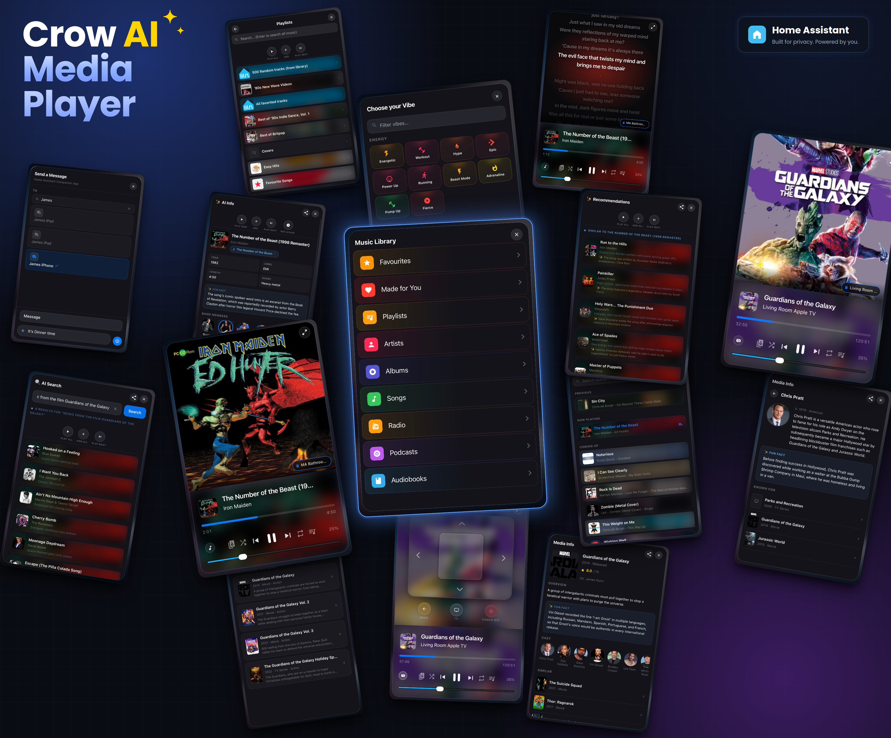

# CrowAI Media Player Card

CrowAI is a Home Assistant media player card built specifically for **iPhone**. Designed from the ground up for iPhone, it brings frosted-glass aesthetics, fluid touch animations, full Music Assistant integration, synced lyrics, a queue browser, multi-room multicast playback, rich AI-powered media info panels, movie and TV info, an Apple TV remote, twelve retro and modern skins, and the option to play on the iPhone itself — all in a card that feels like a native iPhone app.

CrowAI is about **discovery** as much as playback — AI-powered info panels, recommendations, artist radio, similar tracks/shows/movies, AI-interpreted library search, Ask / Trivia panels, and personal Music Recap / Video Recap recaps all help you find your next favourite song, album, TV show or film, not just control what's already playing. And when you want something to keep, almost anything can be saved as a PDF, from listening reports to printable CD and DVD / Blu-ray case covers.

> **Music Assistant is required** for Discover (the music library browser), queue management, Vibe Queue Builder, AI Artist Radio, multi-room multicast playback and all MA-specific features.

> **Music Assistant Queue Actions is required** for the Recommended tab, Queue Browser and Library drill-in.

> **AI features are optional and off by default.** Turn on **Enable AI Features** in the editor's AI section to unlock them — they need a conversation agent such as Google Gemini. With AI off, the music info panel shows **Discogs** data, the movie/TV info panel uses **TMDB** if you add a free key, and everything else in the card works as normal.



## Key Features

- **Built for iPhone** — every interaction is optimised for iPhone; touch targets, long-press suppression and layout are all iPhone-first
- **Modern Design** — a **Classic** solid card or a **Glass** frosted-glass card, with an Auto / Light / Dark theme setting, rounded corners, smooth animations and customisable accent colours
- **Skins** — twelve whole-card looks, each with a light and a dark version, chosen under **Skin** in the editor's Appearance section: **Retro Players** (Winamp Classic, Winamp Modern, iPod Classic, iTunes 2005, Windows Media Player and Walkman), **Retro Desktops** (Windows 98, Windows XP and Mac OS X Aqua) and **Modern** (Zune, Spotify Style and Terminal). A skin dresses every screen, panel, menu and popup of the card, with its own title bar, buttons, lists and fonts. Some add an LCD display with a seven-segment clock and a spectrum that moves while music plays, the iPod skin has a working click wheel (Menu, back, forward, play/pause, the centre button for More Info, and a finger round the wheel for the volume), and the Walkman skin turns the artwork into a cassette whose reels turn as the song plays. The Theme setting picks light or dark (or follows Home Assistant's own mode when Theme is Auto); Style and the custom colours sit out while a skin is chosen. **Crow (Original)** is the card's own look. With **Skin in Quick Menu** on (the default), **Skin ›** in the quick menu lets each phone, tablet or computer choose its own skin, remembered on that device; turn it off and every device uses the skin chosen in the editor. In YAML: `skin` (`winamp`, `winamp5`, `ipod`, `itunes`, `wmp`, `walkman`, `win98`, `xp`, `aqua`, `zune`, `spotify` or `terminal`) and `skin_menu`
- **Row Swipes** — swipe a row right or left for its most useful actions, as in Apple's Mail app: right for the "do it" actions such as Add to Queue, Play Next or Pin, left for the "manage" ones such as Info, Remove or More. A short swipe shows the buttons; a long swipe does the one nearest the edge straight away. Press and hold still opens the full menu. It works on songs, library items, history, pins, films and shows throughout the card. On by default, and rows are a little taller while it's on; turn it off with **Row Swipes** in Appearance, or `row_swipes: false` in YAML
- **Player Icon Themes** — eight icon sets: Standard, Modern, Robot (default), Chunky, Retro Player, Sharp, Pixel and LCD
- **Button Icons** — choose the icon for the Discover button and the Apple TV remote button from a set of ready-made icons, or use any Home Assistant icon (e.g. `mdi:bookshelf`). In Appearance, or `discover_icon` / `remote_icon` in YAML
- **Artwork Crossfade** — optional cinematic fade-to-black transition between track changes
- **Apple TV Remote** — built-in remote with a swipe touchpad, Back, TV, an Apps grid and Sleep / Wake, plus a keyboard panel for typing on the TV; open it with the Remote button in the controls bar, or long-press the artwork during a show, movie or video app such as YouTube; tap X or swipe down to close
- **Apple TV Remote Button** — on the left of the controls bar for Apple TVs (on by default, toggle in Player & Controls)
- **Discover Button** — on the left of the controls bar on every other speaker, and on Apple TVs when the Remote button is off
- **Glass Throughout** — with Style set to Glass, the card's confirmations, choosers, toasts and PDF preview use Liquid Glass too, in light and dark
- **PDF Exports** — save info panels, lyrics, listening and watch reports, recaps, pins and lists as PDFs, and print CD and DVD / Blu-ray case covers (see [Export to PDF](#export-to-pdf))
- **Tactile Button Feedback** — glow and blur effects when buttons are pressed
- **Automatic Device Switching** — card follows whichever media player starts playing
- **Compact and Expanded Modes** — toggle between full album art and a space-saving mini player
- **Full Media Controls** — play/pause, track navigation, shuffle, repeat, seek and mute
- **Double-tap to Seek** — double-tap the left or right zone of artwork to seek −15s or +15s
- **Double-tap to Pin** — double-tap the *center* of the artwork to pin whatever's currently playing — a song, movie, TV show, or radio station — with a burst of red hearts floating up from the tap point (grey for unpinning; the heart burst can be turned off with the **Pin Hearts** toggle in Appearance, the pin itself always works). For radio, this uses the same station identification as the LIVE pill, so it only works once the station's been resolved (usually near-instant, but a station that's never been looked up this session may need a moment, or a tap of the LIVE pill first)
- **Pinned Indicator** — a small pin badge in the bottom-left corner of the artwork whenever the current track/movie/show/radio station is pinned, and stays live regardless of which of the card's pin buttons was used. Tap to unpin — shows an iOS-style confirmation first, then the same grey heart-burst as unpinning via double-tap
- **App-aware AI Info** — with AI Features on, tapping the artwork while something that isn't a film or series is playing opens AI Info shaped for the app: YouTube, Vimeo, TikTok and Dailymotion videos (the video, the channel, topics, a fun fact and more to try), Twitch streams (the streamer, the game or category, similar streamers), sport (the event and background on the teams, with no live scores), news channels (the channel and programme only, with no live headlines), workouts in Apple Fitness+, Peloton and the like (the workout, the instructor or tips, what it works), podcasts (the episode and the show), and apps and games open on the Apple TV, including Netflix and others when they aren't saying what's on (what it is and tips). The app's icon sits where a poster would, and tapping it offers to open the app's website. Pills open a short note at the bottom of the screen. YouTube, Twitch, Vimeo and TikTok have a Find on button for the app's own search. Personal videos (Photos, or a file name like IMG_2041.mov) get a simple panel instead of a wrong film match, and music apps on the Apple TV (Apple Music, Spotify and others) open the song's own AI Info. Films and series in Netflix, iPlayer, Disney+, Prime Video and the like keep Media Info. Home Assistant doesn't pass video IDs, so the AI goes by the title and channel and says when it's guessing. Answers are kept like the other AI answers. While something plays in one of these apps the film tools stay out of the way: no Trivia, Mood Match, Find Soundtrack or case printables, no pinning it as a film, and no LIVE radio pill. When an app shares no artwork, the player shows the app's icon instead of the plain TV. An Apple TV that's idle, asleep, off, or paused for half an hour or more shows as nothing playing rather than the last show it played
- **Artwork Tap Actions** — single-tap opens the info panel (music: AI Info or Discogs; TV/movies: Media Info; live radio with track metadata: that track's info); double-tap the left/right edge to seek −15s/+15s, double-tap the center to pin; long-press opens lyrics for music, or the Apple TV remote while a show, movie or video app is playing (or when nothing is showing on an Apple TV)
- **Artwork Zoom** — tap the mini album art in AI Info or album view to see a larger version
- **Mute Toggle** — tap the volume percentage badge or speaker icon to instantly mute/unmute
- **Live Progress Tracking** — real-time playback position updates
- **Audio quality** — tap the artwork while a song plays on a Music Assistant speaker: the info panel shows an Audio Quality box under the details, e.g. **Lossless**, **Hi-Res Lossless** or the lossy format (AAC 256 kbps), with the bit depth, sample rate and source. Needs Music Assistant Queue Actions
- **Sleep timer** — **Sleep Timer** in the quick menu pauses after 15, 30, 45 or 60 minutes, or at the end of the song, turning the volume down gently over the last half a minute and putting it back afterwards. The time left shows in a pill at the top of the artwork (a small moon on the mini artwork in compact mode); tap it to change or turn off the timer. The dashboard needs to stay open for it to run
- **Visualiser** *(start it from **Visualiser** in the quick menu, or have it start by itself with **Start Automatically** in the editor's Visualiser & Screensaver section)* — in place of the album artwork while music plays, visuals that move in time with the song, in the album's own colours. Eleven styles, or **Shuffle Each Song**: **Spectrum Equaliser** (LED bars with falling peaks), **Radial Equaliser** (bars in a ring around the spinning cover), **VU Meters** (a pair of backlit analogue meters), **Waveform** (glowing oscilloscope lines), **Vinyl Turntable** (the cover as the record label, with a tonearm that moves across the record through the song), **Cassette Deck** (the tape winding from one reel to the other), **Pulse Particles** (sparks bursting out on the beat), **Synthwave Grid** (a neon horizon rolling in time with the tempo), **Synced Lyrics** (the current synced lyric line, large, with the lines before and after it faded), **Liquid Colour** (slow blobs of the album's colours swelling with the music) and **Code Rain** (columns of glowing green characters streaming down a dark screen, falling faster and brighter the busier the music). Speakers don't send their sound to the dashboard, so the visuals follow each song's tempo (looked up on Deezer), where the song is up to and its synced lyrics; with **Play on This Device** they follow the actual sound. It shows while music is playing, and pausing or stopping goes back to the artwork. Chosen from the quick menu, the artwork then stays when the music resumes; started by itself, it comes back after the same time left alone. Radio streams get the visualiser too; movies, TV, podcasts and audiobooks keep their artwork, tap the visualiser to go back to the artwork (until the page is refreshed or closed), and **Visualiser** in the quick menu switches style, or back to the artwork, on that device until the page is refreshed or closed (it can be hidden from the quick menu in the editor)
- **Screensaver** *(start it from **Screensaver** in the quick menu, or have it start by itself with **Start Automatically** in the editor's Visualiser & Screensaver section)* — a screensaver over the full-size player's artwork, or over the whole screen with **Full Screen** switched on (see [Full-Screen Screensaver](#full-screen-screensaver)). Start any style from **Screensaver** in the quick menu, or let it start by itself in the style chosen in the editor after a chosen time (30 seconds to 1 hour) with the card left alone, whether or not music is playing; it stays until tapped (or until music starts, unless it was set to start by itself as a screensaver). Tap anywhere on it to close it. **Auto Start**, a switch at the top of the quick menu's **Screensaver ›**, turns starting by itself on or off for that device without opening the editor (after the time set in the editor, or 10 minutes if none is set). Eleven styles, or **Shuffle** to change style every five minutes: **Album Wall** (a grid of recent album covers, flipping over one tile at a time), **Rain on Glass** (raindrops gathering and running down a window over a blurred album cover, each drop showing the cover upside down like a little lens), **Ambient Aurora** (an aurora that slowly shifts through greens, teals, blues, violets, pinks and ambers, with curtains of light swaying across a starry sky), **Lava Lamp** (glossy blobs rising, merging and sinking in a glowing lamp, in the colours of the last song's album cover, drifting gently around them; a cover with no real colour gets slowly changing colours instead), **Night Sky** (thousands of twinkling stars and the Milky Way flowing slowly up across the sky over hazy hills and pine trees, the odd shooting star and tonight's moon in its real phase), **Fireplace** (flames licking up in the dark, white-hot at the base and cooling through yellow and orange to red at the tips, with sparks rising and the darkness around them warmed by the firelight), **Ocean** (a rippling sea under a sky that follows Home Assistant's sun: dawn pink, midday blue, dusk orange and deep blue with the moon and stars at night, with a sparkling path of light under the sun or moon. Now and then something happens, one thing at a time: dolphins leap alone or in a pod, seabirds glide over, or a whale spouts far out and lifts its tail. The screensaver's weather entity sets the clouds and the sea: glassy when it's still, choppier with white caps in the wind, with a rain shower hanging out on the horizon when it's raining and silent lightning in a storm), **Clock & Weather** (a big clock and the date, over an animated sky with drifting clouds, sun, moon, stars, rain, snow or lightning to match the weather when a weather entity is chosen), **Flip Clock** (split-flap digits that flip over as the minutes change), **Analogue Clock** (a dial with a smoothly sweeping second hand, in any of twelve faces chosen in the editor, Luxury by default) and **Word Clock** (the time spelled out in a grid of letters, such as "IT IS TWENTY PAST TEN", lit in the album's colour when there is one). A small clock and the date (and the weather) can sit in the corner of the styles that don't show the time themselves. No account or key needed
- **Multi-Device Management** — control Apple TV, HomePod and Music Assistant speakers from a single card
- **Play on This Device** — optional: turn the iPhone (or any browser) showing the card into a Music Assistant speaker, so music plays from the phone itself
- **Volume Control** — slider or +/− buttons, with optional per-speaker routing to a separate volume entity, configured on that speaker's own settings page in the editor
- **Speaker Display Names** — give any speaker a short friendly name on its settings page in the editor; used everywhere the card shows a speaker (speaker menu, summary pill, group sheets, Announce, toasts) while Home Assistant keeps the real name
- **Album Artwork** — automatic iTunes artwork lookup when no artwork is provided
- **Ambient Glow** — extracts dominant colour from album artwork and applies a subtle glow
- **Radio Mode Indicator** — tap the radio icon to turn radio mode off immediately
- **HA Radio Browser Integration** — browse Home Assistant's own Radio Browser categories (Popular, By Country, By Genre, etc.) directly from the Radio tab, alongside direct radio-browser.info search
- **Live/Podcast/Audiobook Pill** — optional badge identifying what's currently playing (off by default)
- **In-card Notifications** — toast alerts appear inside the card. Home Assistant's own "Failed to perform the action" bar never pops up over the dashboard: when something the card asks Home Assistant to do fails (an Apple TV button, a volume change, an announcement, a message, grouping speakers), a short message in the card says so instead, once rather than a stack of them
- **Controls Theme** — 12 colour presets for the control icons (Classic, Vivid, Warm, Ocean, Rose, Forest, Neon, Soft, Midnight, Gold, Retro, Ember)

## Full-Screen Screensaver

Turn on **Full Screen** in the editor's **Visualiser & Screensaver** section (under Screensaver) to have the screensaver cover the whole screen, Home Assistant's header and sidebar included, rather than just the album artwork. It's off by default.

- **Every style is made for full screen** — the clocks, digits and dials scale with the screen, the Album Wall keeps its covers square (more rows on an upright phone, more columns on a wide screen, laid out again when a tablet is rotated), the Lava Lamp, Fireplace and Rain on Glass stay in proportion, and the Aurora keeps its glows round and fills the sky with stars
- **Notches and home bars** — the clock and text stay clear of them on iPhones and iPads
- **Any tap on the dashboard counts as using it** — so it won't appear while someone is using a different card on the same screen
- **Works from a compact player too** — the card doesn't need to be showing its artwork
- **Tap anywhere to close** — the tap doesn't fall through to whatever is underneath. Escape closes it on a computer
- **One at a time** — with several CrowAI cards on a dashboard, only one goes full screen. It never starts by itself from the card editor's preview, and it closes when you switch to another view
- **Light on the processor** — on very large or high-density screens the animated styles cap how sharply they draw, and Night Sky and Rain on Glass cap how many stars and drops they draw, so wall panels and Raspberry Pi kiosks stay cool
- **Keeping the screen on** — the card can't keep an iPhone or iPad awake inside the Home Assistant app. For a wall or bedside tablet, turn on **Keep screen on** in the Home Assistant app's own **Kiosk mode** (Settings, Kiosk mode), or set the device's Auto-Lock to Never

## AI Features

AI features are **off by default** — the card works fully without them, using Discogs for the info panel. Enable them with the **Enable AI Features** master switch at the top of the editor's **AI** section, then set up a conversation agent — **Google Gemini** is recommended.

**Setup (Google Gemini):**

1. In [Google Cloud Console](https://console.cloud.google.com), create or pick a project, go to **APIs & Services → Library** and **Enable** the **Generative Language API**. Don't skip this: an API key won't work until it's enabled.
2. Go to **APIs & Services → Credentials**, click **+ Create Credentials → API key** and copy the key.
3. In Home Assistant go to **Settings → Devices & Services → + Add Integration**, add **Google Generative AI** and paste your key. The recommended model settings work fine. If you choose a model yourself, pick a **current Flash model**, because Google retires older models regularly.
4. In the card's visual editor, open **AI**, turn on **Enable AI Features**, and choose your Google AI agent under **AI Agent**.

Other conversation agents (Claude, OpenAI, Home Assistant's built-in AI, Ollama, etc.) may also work for general-knowledge features, but Gemini is recommended and best-tested.

**Rate limits:** free-tier limits vary by model and change over time, so check Google AI Studio for your current quota. The card caches AI answers for up to 30 days (and through app restarts with AI Info on under Keep in Home Assistant), so you're unlikely to reach the limit in normal use. If you do see a quota message, it resets the next day.

- **AI Info Panel** — single-tap the artwork while music plays: year, label, length, fun fact, genre tags, band members / artist section, album pill, up to 10 similar tracks; all cached per track. The header reads "AI Info" for an AI answer and "Discogs Info" when Discogs filled in. **Try First** in the editor's **Info Panels** section chooses whether AI or Discogs is tried first
- **Ask, Meaning and Trivia** — buttons in the music info panel: ask your own question about the song, read what it means, or try a quiz. Movie and TV panels have Ask, Mood Match and Trivia, episode pages have Ask, Trivia and Soundtrack, and person pages have Ask and Trivia
- **Discogs Panel** — the default info panel when AI features are off, and the automatic fallback when AI can't identify a track: year, label, length, tappable genre tags, artist section and a full tracklist with community rating, in the same layout. The header reads "Discogs Info" instead of "AI Info" so it's clear where the data came from; tapping a tracklist row opens that track's own info, and the row for the track you're viewing is highlighted. Built-in rate-limit protection backs off automatically for 10 seconds whenever Discogs asks the card to slow down.
- **Song Intro** — a short, intriguing one-line fact about the playing track appears below the artist name a few seconds after it starts, then fades away; off by default, toggle in the editor's AI section
- **Vibe Queue Builder** — 100+ vibes across Energy, Calm, Focus, Mood, Social, Activity, Decades, Genre, Time, Seasons and Binaural & Noise; builds a themed MA queue instantly; artist exclusion prevents repeats
- **Add Songs from Same Year / Genre / Genre & Year** — quick-menu actions that add AI-picked songs matching what's playing
- **Working indicator** — while the card is building or adding to a queue (Add Similar Songs, Same Year / Genre, AI Artist Radio, Vibe), a small spinner shows inside the mini artwork and the speaker pill on the artwork pulses. Both stop as soon as the songs are in. The first few songs are added straight away so the queue starts filling while the rest are found. The queue can't be opened mid-build: tapping it says your songs are still being added, and a message tells you when they're ready to see. If the queue is already open it shows "Building your queue" until they are
- **Friendly error messages** — if the AI or Music Assistant can't help, a short toast says why in plain English: the AI's usage limit has been reached, it took too long, it couldn't sign in, the model has been retired, no AI agent is chosen, its answer didn't make sense, or the songs couldn't be found in Music Assistant (including "Added 12 of 18 songs" when only some were found)
- **Mood Match and Trivia for video** — in the quick menu while a movie or show is playing
- **Ghost-Skip Healer** — when Music Assistant silently skips a track that failed to stream, the card looks it up again and queues the fresh match to play next (on by default)
- **AI Search** — natural language search, up to 18 results per query; available as a standalone panel, a box at the top of Discover, and a dedicated AI search button next to the Songs, Artists and Albums tab search bars (returning matching tracks, artists or albums respectively); set **Library Search** to **AI Enhanced Search** to make pressing Search use AI too
- **Recent Searches** — a category at the top of Discover listing every search you've run (MA, iTunes-backed and AI alike), capped at 50, most-recent-first; tap to re-run, with an iOS-style Clear confirmation
- **Recommendations** — AI-curated track/movie/show suggestions based on what's playing, up to 18 results
- **AI Artist Radio** — continuous radio queue around any artist
- **Find Soundtrack** — from the quick menu while watching on Apple TV, the long-press menu on Movies & TV items, or the Soundtrack button on Watch History titles and episode pages — opens an AI Search for that title's music
- **Watch on YouTube / Watch Trailer** — the first item in the Info panel's 3-dot menu: Watch on YouTube opens a YouTube search for the song, and Watch Trailer opens the trailer for a movie or TV show (also a round Trailer button next to Pin under the poster). Always YouTube specifically, regardless of your configured Share service. Turn it off with **Watch on YouTube** in the editor's Info Panels section (Extras)
- **Announce AI Improve** — rewrites your announcement in a natural, friendly tone
- **Send Message AI** — improves your notification text
- **Audiobook search** — AI-assisted query refinement when searching LibriVox/Archive.org for public-domain audiobooks (plain search works without AI)
- **Music Recap** — a personal weekly snapshot of what you've been playing: top artists and tracks (last 7 days, top 10 each, expandable to 50) plus a short AI-written summary that regenerates fresh every time you open it
- **Video Recap** — the same idea as Music Recap, for movies and TV shows: top shows and top movies over the last 7 days plus a fresh AI-written summary every time you open it

## When AI Is Off or Can't Help

Every AI option (Search, Vibe, Recommendations, AI Artist Radio, the Add to Queue songs, Find Soundtrack, Ask, Trivia, Mood Match and the Announce / Send Message improve buttons) is hidden throughout the card while **Enable AI Features** is off, including in the quick menu, the queue's 3-dot menu and every long-press menu, and the card never contacts the AI agent. Where a panel normally gets its details from the AI, it falls back to a free source instead, both when AI is off and when the AI doesn't recognise something:

| What | Fallback |
|------|----------|
| Track info | Discogs |
| Album view (tracklist, year, label, genres) | Discogs |
| Movie and TV info | TMDB (with a key), then TVmaze for TV shows, then Wikipedia |
| TV seasons and episodes (counts, titles, air dates, summaries) | TVmaze |
| TV Tonight (UK) | The Freeview programme guide, with channel logos, from free community-maintained listings |
| Artist, band member, cast and director bios | Wikipedia |
| Genre pill descriptions | Wikipedia |

None of these need an account or key apart from TMDB. Wikipedia results are kept for the session only, so turning AI back on gets the richer AI version next time; TVmaze lists are saved for 2 days while a show is airing and 7 days once it's ended, so new episodes and seasons appear quickly. TVmaze also fills in any details missing from an AI or TMDB TV panel, such as cast or overview, and a panel built entirely from TVmaze reads "TVmaze Info". The Year box in the music info panel opens "This year in music" only when AI is on; with AI off it shows the year as plain text.

> **Recommended:** in the editor's **Info Panels** section, set **Try First** to **Discogs with AI Extras** for songs and **TMDB with AI Extras** for movies and TV (TMDB needs a free API key). You get the accuracy of Discogs's and TMDB's own records (the right year, label, cast, poster and rating) together with the AI's extras on top: Ask, Meaning or Mood Match, Trivia and fun facts. It usually uses less AI quota than AI First too, since the facts come from Discogs and TMDB rather than the AI. The fun fact shows a **Finding a fun fact…** placeholder while it's looked up (for songs it's asked for on its own, so it arrives ahead of the similar tracks) and quietly disappears if none turns up.

**When the AI is struggling.** If the AI runs out of quota, keeps timing out, can't sign in or has no agent, the card pauses it and goes straight to the fallbacks above instead of waiting for each request to fail. A usage-limit pause lasts 2 minutes, then 10, then 30 if it keeps happening; two timeouts in a row pause it for 2 minutes; sign-in, model and agent problems pause it until the AI settings change or the page reloads. You get a single message when a pause starts, and the editor's **AI** section shows the current state with a **Try AI Again** button. Panels with a fallback give the AI 25 seconds to answer before using it. If the AI misses a particular track, tapping that track's artwork again later in the session opens the Discogs panel straight away, while the card quietly retries the AI once in the background so the full AI panel can return next time.


**Choosing which AI features run.** Under the master switch, the **AI** section has an **AI Features** list so you can turn individual features off to save quota: **Look Up in Advance** (fetching AI info in the background before you tap; *off by default*), **Search and Recommendations**, **Ask, Meaning and Trivia**, and **Recap Summaries**. AI in the info panels is switched with **AI Details** in the **Info Panels** section (Extras). Anything switched off is hidden or falls back to the card's normal behaviour. When Ask, Meaning, Trivia or Mood Match can't get an answer, the panel shows a short reason ("Limit reached", "Busy right now", "No reply"…) with a **Try Again** button. A "busy" answer from the AI service is retried once automatically, identical requests already on their way are shared rather than sent twice, and every prompt tells the AI to treat titles, descriptions and web text strictly as data. If AI is on but no usable agent is chosen, the AI section shows a warning under the AI Agent box.

## Quick Menu

Tap the playlist/queue button in the controls bar to open the contextual quick menu. Related actions are grouped into sub-menus so it fits on a phone screen: tap a group (shown with › and how many items it holds) to slide its items in, and ‹ at the top to go back. A group with only one item available shows that item directly, and the menu always fits on screen, scrolling if it needs to.

- **Find & browse** — Queue (MA speakers only), Search (your Music Assistant library), AI Search (natural language search), Discover
- **Discover & build** — Vibe, AI Recommendations, AI Artist Radio, **Add to Queue ›** (Add Similar Songs, Add Songs from Same Genre, Same Year or Same Genre & Year, Add Album), Radio Mode
- **What's playing** — Lyrics, Visualiser, Screensaver (with an **Auto Start** switch at the top), Skin › (this device's own skin, when **Skin in Quick Menu** is on), Sleep Timer, Pin / Unpin, AI Mood Match and AI Trivia (while a movie or show plays), Remote Control (Apple TV — opens or closes the remote), Open App (Apple TV), Find Soundtrack (while watching on Apple TV)
- **Recaps ›** — Music Recap, Video Recap
- **Export ›** — for what's playing: Lyrics (when the song has them), then CD Case Printables for a song or DVD / Blu-ray Case Printables for a show or film; then Listening Report, Your Month in Music, Recently Played, Watch Report and Pinned Items
- **Share & Announce ›** — Share (track info plus a link to your chosen music service), Announce, Send Message
- **More Info** — at the bottom, opens the AI or Media Info panel

The AI entries (AI Search, Vibe, AI Recommendations, AI Artist Radio, the Add to Queue songs, AI Mood Match, AI Trivia, Find Soundtrack) only appear when **Enable AI Features** is on, and the same goes for the queue's 3-dot menu and every long-press menu.

## Speaker Selector Menu

Tap the broadcast icon to open a popup showing all configured media players. Tap any entry to switch. Speakers appear under their Display Name if you've set one on their settings page in the editor. With **Play on This Device** turned on, the menu also has **Play on this device** (see below).

## Play on This Device

Turn the browser showing the card — your iPhone, a tablet or a computer — into a Music Assistant speaker, using Music Assistant's **Sendspin** protocol. Needs **Music Assistant 2.10 or newer**.

- Turn on **Show "Play on this device"** in the editor's **Play on This Device** section
- Each device opts in separately: tap **Play on this device** in the speaker menu on that device. It joins Music Assistant with a name like "James's iPhone (Safari)" (the browser is included so two browsers on one phone never share a name; rename it in Music Assistant) and appears in the card like any other speaker
- **Browsers only** — it's offered in a web browser such as Safari, not in the Home Assistant Companion app. If the app was set up as a speaker by an earlier version of the card, it switches itself off; delete its leftover player in Music Assistant
- **Setting up** — the first time, the menu shows "Almost ready — adding this device to Home Assistant" for a few seconds, then "Ready — tap to play on this device" (it updates while the menu is open). If Home Assistant still hasn't found it after 90 seconds, the menu says so and offers **Choose this device yourself…** to pick its entity from a list
- **Connecting** — while it connects, the speaker pill reads "This device · Connecting…" and pulses, and a spinner shows in the mini artwork. A short toast marks the start, "Ready — playing on this device" when it's done, and a plain-English reason if it couldn't connect within 20 seconds. Reconnects in the background (for example coming back to Safari) stay quiet unless they take more than 3 seconds, when the pill shows "Reconnecting…"; you only get a toast if that fails
- Once it's the selected speaker, **Disconnect this device** turns it off again
- Only one browser tab plays at a time: if another tab took over, the menu offers to play here instead. If the tab that was playing has been closed or frozen by the phone, the next tab you use takes over by itself
- **Coming back** — after switching apps or returning to a frozen Safari tab, the card reconnects straight away and wakes the audio on your next tap, including when another app interrupted it
- **If a song won't resume** — pressing play checks that sound actually starts. If it doesn't, the card reconnects and asks again, then restarts the song from the same spot, and only as a last resort stops it with a message so you can simply play it again
- **Status** — when this device's audio needs waking, the speaker menu says so (for example "Audio was interrupted by another app. Press play to wake it.")
- **Locking the phone** — Safari pauses web pages when the iPhone locks, so music stops a few seconds later. That's a Safari limit; keep the screen on (or use a dedicated speaker) for longer listening
- Volume works as for any speaker: the card's slider changes this device's loudness, on top of the phone's own volume buttons. Each device remembers its own volume (and mute) between connections; the very first time it starts at 50% rather than full volume
- **Music Assistant server URL** — leave blank to use your Home Assistant host on Sendspin's port 8927 (not Music Assistant's web port 8095). If you open Home Assistant over https, this must be an https address too, or the browser will block the connection

## Multi-Room Multicast

Play the same audio on multiple MA speakers simultaneously:

- **Choose Speakers picker** — tap the broadcast icon to start a session: speakers are shown as a scrollable vertical list of pill rows (tap multiple to select for multicast); Play stays pinned at the bottom of the panel so a long speaker list never pushes it out of reach
- **Summary pill** — a single compact pill showing the focused speaker's name and a "+N" count of others in the group, instead of a separate pill per speaker
- **Tap to manage** — opens a sheet listing every speaker in the group as the same style of pill row; tap any to focus it for volume control, tap the × to remove it
- **Sync Volume** — a button in the sheet matches all grouped speakers to the focused speaker's volume
- **Add a speaker** — a "+" button appears next to the summary pill (and next to solo speakers, when others are available to group with) once something is actually playing
- Long-press menus for individual tracks/albums/etc. always target your current/default speaker directly rather than offering an in-menu speaker picker — use the "+" button to bring extra speakers into a multicast group instead
- Pre-configured Music Assistant player groups (e.g. a permanently-synced stereo pair) can be played on individually, but can't be folded into a separate multi-room session — a Music Assistant limitation, not a card one

## Pinning (Library)

Pin your favourites for one-tap access. All pins also live together in a consolidated **Pins** section in Discover, with its own sub-categories: Songs, Artists, Albums, Playlists, Queues, Radio, Podcasts, Audiobooks, Music Recap, Video Recap, Movies & TV and Charts.

- **What can be pinned** — radio stations, podcasts, audiobooks, movies and TV shows, saved queues (see Pin Queue as Playlist below), recap snapshots, and MA library tracks, artists, albums and playlists
- **How to pin** — long-press any item and choose Pin/Unpin, or tap **Pin** in the row of round buttons under the artwork in its info panel (it turns yellow and reads Unpin once pinned); for whatever's currently playing (a song, movie, TV show, or radio station), double-tapping the center of the artwork does the same thing instantly, with a heart-burst animation to confirm it. Unpin shows in red in every menu, and unpinning anything asks first with an iOS-style confirmation; pinned queues and recaps also warn that the snapshot can't be recreated
- **Show Pins in Sections** *(on by default)* — when enabled, pinned items also still appear inline at the top of their own tab (e.g. Pinned Songs in the Songs tab); turn it off in the editor's Discover section so pins only appear in the consolidated Pins section
- **Management** — view and clear pins individually or all at once from the visual editor's Caches, Data & Support section (Clear All Pins)
- Pins are stored on-device only by default and aren't synced between browsers or devices
- Turn on **Pins** under **Keep in Home Assistant** in Caches, Data & Support to also save pins to Home Assistant, so they survive app restarts and cache clears
- **Apple TV App Icons** keeps the icons for the remote's Apps grid and the app Info panel, the images themselves, on this device and in Home Assistant, so they appear straight away after the companion app is closed and reopened and on your other devices. Apps the App Store doesn't have, or that haven't come back yet, show their website's logo. **Clear** removes them everywhere and they're fetched again (Clear All Caches clears them too)
- **Clear All Caches** clears every cache but leaves your own things alone: pins, saved stations and queues, Music and Watch History, muted artists, favourite announcements and remembered choices. Use **Clear All Pins** to remove pins, and **Clear Persistent Storage** to also remove the copy kept in Home Assistant

## Pin Queue as Playlist

Save the current queue as a named snapshot from the queue's 3-dot menu — **Pin Queue**. It's a point-in-time copy (not a live link to the original queue) and shows up under **Queues** in the consolidated Pins section, ready to play back in full any time.

## Persistent Storage

By default, pins, AI lookups, iTunes artwork, Wikipedia photos and lyrics are cached in the browser only, which means they can be lost to WKWebView cache evictions or app restarts. Each of these can be kept in Home Assistant as well, under **Keep in Home Assistant** in the editor's Caches, Data & Support section, which saves them to your Home Assistant user so they survive app restarts and are on your other devices:

- **Pins**, **Lyrics**, **AI Info** (track info, bios, recommendations, listening and watch history, etc.), **iTunes Artwork** and **Wikipedia Artwork** each have their own switch
- Persistent data is loaded once per session and merged with the on-device cache — Home Assistant's copy always wins on conflict
- A **Clear Persistent Storage** button (separate from the regular cache-clear buttons) removes everything saved this way
- **Wikipedia photos** (cast, artists and band members) are also kept on the device after their first download, so they appear almost instantly on later visits, even after the app restarts. This needs Home Assistant to be opened over https (for example through remote access); over plain http they're downloaded again each session

## Synced Lyrics

Long-press the artwork while music is playing to open the full-screen lyrics panel. Single-tap to close.

- Real-time line highlighting with a smooth, continuous auto-scroll: the lyrics glide through each line like a teleprompter, arriving just as the next line starts, and the current line grows gently as it reaches its place. It follows the progress bar exactly, even straight after a seek
- Double-tap to pause/resume auto-scrolling
- Swipe to look through the lyrics yourself; a few seconds after you let go, they glide back to where the song is
- Plain lyrics fallback when timestamps aren't available
- Background prefetch — opens instantly
- Auto-close when track ends or changes
- **Translate Lyrics** — tap **⋯** in the top-left corner of the lyrics, then **Translate Lyrics**: a translation under each line, with pronunciation for scripts such as Japanese, Korean or Russian. Uses the AI (needs AI Features on); each translation is kept, so it's instant next time. **Hide Translation** turns it off
- **New Releases** — at the bottom of the music info panel (tap the artwork): albums, EPs and singles the artist playing has put out in the last year, or that are due soon, from MusicBrainz. Dated by when each record first came out, so reissues and remasters of old albums don't count, and the section stays hidden when there's nothing new. Tap one for its songs, long-press to play or queue it
- **Charts** *(off by default — switch it on in the editor's Discover section)* — a **Charts** section in Discover. Under **Apple Music**: **Top Songs** and **Top Albums** (each opens its songs), for your country (the one set in Home Assistant). Below Apple Music are the charts on Deezer's front page, each its own section: **Official Charts** (UK), **Charts** (Top Worldwide, your country, USA), **Trending**, **Popular Playlists**, **Most-streamed Artists** (their top songs) and **Most-streamed Albums**. Each chart opens on the Top 10, with Top 50 and Top 100 in the ⋯ menu, and the usual **Play All**, **Add**, **Play Next**, **Pin** and **Export** buttons. Tap a song for its info panel, long-press for Play Next, Add to Queue and the rest. Songs are found through Music Assistant, and any it can't find are skipped and counted. Everything you open in Charts is fetched once a day and kept on your device until midnight, even if you reload or close and reopen the app. While a chart loads, the line under the spinner says what it's doing. Apple Music and Deezer each have their own switch under Charts in the editor; switching both off turns Charts off. A pinned chart sits in **Pins → Charts** and always opens the latest version. No account or key needed
- **Movie & TV Charts** — a **Charts** row at the top of Discover's **Movies & TV** section. Inside: **Apple TV** (Top Movies, Top TV Shows), **TVmaze** (TV Tonight, New on Streaming) and, when a TMDB key is added in the editor, **TMDB** (Trending This Week, Popular Movies, Now in Cinemas, Coming Soon, Top Rated Movies, Popular TV). Titles open the usual Info panel and long-press pins a title; each chart has **Pin** (live, named, in Pins → Charts) and **Export**. Kept until midnight. On by default — switch it off in the editor's Discover section. In the UK, **TV Tonight** comes from the free Freeview guide, channel by channel with each channel's logo: what's on now with a progress bar, then the rest of the evening, with more behind **more tonight**. Tap a programme for its picture, times, episode, synopsis, an **Info** button and a **Watch on** button for the broadcaster's live page or app; the X closes it and takes you back to the list. To show your own channels (a regional BBC One or ITV1, say), list their guide channel IDs under `tv_tonight_channels` in the card's YAML. Outside the UK, or if the guide can't be reached, TV Tonight uses TVmaze as before. The TV guide has its own **TV Guide** switch under Movie & TV Charts in the editor (the editor's Discover section); with it off, TV Tonight shows TVmaze's listings instead.
- **Podcast Charts** — at the top of Discover's **Podcasts** section: Apple Podcasts' **Top Podcasts** for your country. A podcast opens its usual info panel with episodes and Pin. Refreshed once a day. On by default — switch it off in the editor's Discover section

## Sharing

Share is available from the quick menu, the info panels, and the long-press menu on any queue row. It copies everything to the clipboard — there's a toast confirmation when it's done. In the info panels, the 3-dot button in the header opens a menu instead (see [Export to PDF](#export-to-pdf)):

- **Copy to Clipboard** — the same as Share
- **Export Info to PDF**
- **Song Lyrics** — a folder in the share menu of a song's Info panel, for any song, playing or not (for example one you're browsing in Discover), holding **Lyrics** and **Export to PDF** (the lyrics as a PDF). Lyrics opens them over the Info panel (for the song that's playing, the card's own lyrics view opens instead, in time with the music). The folder appears once lyrics are found, with a spinner while they're being looked up
- **Song Lyrics → Export to PDF** — music with lyrics
- **CD Case Printables (PDF)** — music
- **DVD / Blu-ray Case Printables (PDF)** — movies and TV shows
- **Export Episodes to PDF** — podcasts

Sharing itself:


- **Music** — copies the track title and artist (plus album, where shown) along with a link to find the track on your chosen streaming service
- **Movies & TV** — copies the title, year and a short synopsis along with a link to find it on TheMovieDB
- **Choose your service** — pick the destination for music links in the editor's Discover section: YouTube Music (default), Apple Music, Spotify, Tidal, Amazon Music or Deezer

## Export to PDF

Almost everything in the card can be saved as a PDF. A preview opens straight away with a progress spinner, then shows the finished PDF with a **Download** button. Every type can be switched off in the editor's **Export & PDF** section; a type that's off disappears from every menu and hero bar.

| PDF | Where to find it |
|-----|------------------|
| Info | Share menu on every info panel (music, Discogs, album, movie and TV, season and episode, person, podcast, station and audiobook). The PDF button on a TV show's seasons page makes an episode guide |
| Lyrics | Share menu in music panels, quick menu **Export ›**, album pages (a lyrics booklet for the whole album) |
| CD Case Printables | Share menu in music panels, quick menu **Export ›** while a song plays, album pages |
| DVD / Blu-ray Case Printables | Share menu in movie and TV panels, quick menu **Export ›** while a show or film plays, a Watch History title's ⋮ menu, and long-press on any Movies & TV row (Watch History, Video Recap, Movies & TV search, Pins) |
| Listening Report | Quick menu **Export ›**, Music History ⋮ → **Export to PDF**, the Music History hero bar's **Export**, Music Recap ⋮ → **Export Report to PDF** |
| Your Month in Music | Quick menu **Export ›**, Music History ⋮ → **Export to PDF** |
| Recently Played | Quick menu **Export ›**, Music History ⋮ → **Export to PDF** (choose a speaker) |
| Watch Report | Quick menu **Export ›**, Watch History ⋮ → **Export Report to PDF**, Video Recap ⋮ → **Export Report to PDF**, and a title's **Export** button for that title's history. Includes a YouTube section (videos, time, top channels, when you watch and the videos themselves) whenever YouTube was watched in the period, kept apart from the films and shows |
| Recaps | Music Recap and Video Recap ⋮ → **Export Recap to PDF**, and **Export** on a pinned recap |
| Pinned Items | Pins ⋮ → **Export Pins to PDF**, and **Export** on pinned songs |
| Lists & Results | Queue ⋮ → **Export Queue to PDF**, saved queues, album tracklists, playlists and artists, AI Search and Recommendations (**Export Results to PDF**), podcast episodes (**Export Episodes to PDF**) |

- **Reports ask for a period** — Today, Last 7 days, Last 30 days, Last 90 days or All time
- **Album pages** — **Export** on a library or AI album page offers Tracklist, Lyrics booklet or CD case printables. Only the types that are on are offered, and if just one is left it goes straight to it
- **Music and other panels** — the title and artist as the heading, the artwork beside the grey Year / Label / Length / Genre rows, then everything else on screen in order: Fun Fact, Band Members on one line, Similar Tracks in two columns, tracklists, and anything you've opened with Ask, Meaning or Trivia. Web addresses (a station's website or stream) are clickable
- **Movies and TV** — the title and year as the heading, the poster beside the user-score ring and grey Type / Seasons / Creator or Director / Genre / Rated rows, then Overview, Fun Fact, Cast in columns, Where to Watch and Similar
- **Lyrics** — the song and band as the heading, the artwork beside the grey detail rows (centred on its own when there's no artwork), then the lyrics centred, running onto further pages as needed. Offered when the track has lyrics, which are looked up when the menu opens if they aren't already known
- **Instant the second time** — finished PDFs and the details looked up for them are kept for the session, so reopening one doesn't fetch everything again. They're cleared when the page or the Home Assistant app closes. Lookups that failed aren't kept, so trying again searches afresh
- **Friendly errors** — if a PDF can't be made, an iOS-style alert says why, such as "You're Offline", "No Artwork Found", "No Lyrics Found" or "Couldn't Make the PDF"
- **Glass** — with Style set to Glass, the preview, its alerts, the chooser and the Download button use Liquid Glass, in light and dark
- **Not this one?** — CD and DVD / Blu-ray cases have a **Not this one?** button under the preview (and on their error alerts). It lists other matches with their artwork, and has a search box for anything else. Pick one and the case is made again straight away. Your choice is remembered on that device for that title or album, and a film or show you choose is used by its info panel too

### CD Case Printables

Print-and-cut inserts for a standard CD jewel case:

- **Sizes** — front cover 120 × 120 mm, back tray card 150 × 118 mm with fold marks for the spines, a 118 mm disc label with a 36 mm hole, and booklet pages
- **Artwork** — the album's own front and back covers from MusicBrainz and the Cover Art Archive first, then the info panel's artwork, iTunes album art (1200 px) and finally the now-playing artwork
- **No back cover?** — the card makes a tracklist back from MusicBrainz in one to three columns, numbered by disc (D1-1) for multi-disc albums, with a faint black-and-white copy of the front cover behind it (switch it off with **Cover on the Back** under Export & PDF). A real back cover scan is never changed
- **Album artist** — taken from the album itself, not the song playing. Compilations credited to Various Artists leave out the artist line and spine name
- **No artwork anywhere** — a **No Cover Art Yet** alert offers **Make with Title Cards**, **Add Cover on MusicBrainz** (or **Find It on MusicBrainz**) and **Not Now**
- **Format marks** — a made tracklist back gets a small CD mark at the foot of each spine and a strip along the bottom with a Compact Disc mark, the label, year and running time; a disc label made from the front cover (or a plain one) gets a small CD mark near the edge. Scanned artwork is left as it is. The marks are the card's own design, not any official logo, and can be switched off with **Format Marks** under Export & PDF

### DVD / Blu-ray Case Printables

Print-and-cut wraps for a standard DVD or Blu-ray case, for both films and TV shows:

- **Sizes** — DVD wrap 273 × 183 mm, Blu-ray wrap 272 × 149 mm, each with a 14 mm spine, plus a 118 mm disc label. Pages are A4 or US Letter to match your region; set `cd_paper_size` to `a4` or `letter` to choose
- **Back and spine** — a colour gradient taken from the poster, headings in a matching accent colour with full-width underlines, and a slightly darker spine showing just the title. With **Cover on the Back** on (it is by default), a faint copy of the poster fills the back panel, stopping at the spine
- **Films** — tagline, synopsis, a **Film details** grid (Written by, Music by, Cinematography, Produced by, Studio, Released, Country, Language, Box office, Budget), **Starring** in one column with character names when most of the cast have them, and Directed by. A strip along the bottom shows the certificate (your local rating, such as the UK one), Running time, Year, Rating and Genre
- **TV shows** — synopsis, an **Episode Guide** with every episode title (the text gets smaller, then splits into two columns, so long series still fit), Starring and Created by, then a strip with the certificate, Runtime, Years (for example 2022 - 2026), Seasons, Rating and Genre
- **Where the details come from** — the info panel if you've opened it, then TMDB, TVmaze, Wikipedia and Wikidata, and the iTunes Store. A TMDB key isn't needed, but it fills in more. Dates are written day, month, year
- **Titles with a colon** — such as Star Trek: Strange New Worlds or Mission: Impossible — are matched in full, so you get the right show or film
- **Show or film?** — when the player doesn't say a title is an episode, an exact match decides. Breaking Bad is a show on TVmaze and not a film, so it gets the series case rather than El Camino
- **Format marks** — a small DVD or Blu-ray mark at the foot of the spine, a DVD Video or Blu-ray Disc mark at the right-hand end of the strip on the back, and a small mark below the title on the disc label. They're the card's own design, not any official logo, and can be switched off with **Format Marks** under Export & PDF

The PDF library (jsPDF) loads from a CDN the first time you export, and the preview uses PDF.js. Artwork that a site won't let the card copy is fetched through the images.weserv.nl image proxy; if that fails too, the PDF is made without it. The PDF's built-in fonts only cover Western characters, so non-Latin text is left out. In the Home Assistant app on iPhone the Download button may not save the file, depending on the app version; it works in Safari. When printing a case, choose **Actual size** (100%), not Fit to page.

## Media Info Panels

**Single-tap** the artwork to open the relevant info panel.

**Music — AI Info Panel:**
- Year, label, length, fun fact, genre tags
- Album pill — tap to open the album and browse its tracks; tap album art to zoom
- Band Members / Artist — tap any member to open their bio with photo (tap to zoom), Known For songs and fun fact
- Similar Tracks — tap to drill in, long-press for the enqueue menu
- Mini album art — tap to see a larger version
- Action bar: Play Now, Add, Play Next, Add Album. **Play Now** closes the panel (and Discover) and takes you back to the player
- **Ask / Meaning / Trivia** (AI) — ask your own question about the song, read its meaning, or try a quiz
- **Discogs Panel** — the default panel when AI features are off, and the automatic fallback if AI has no info for a track: same layout with a full tracklist and community rating added; the header reads "Discogs Info" rather than "AI Info". Tapping a track in the Discogs tracklist opens that track's own info — the track the panel is showing is highlighted in the tracklist, tapping it jumps back to the top of the panel, and every newly opened track starts at the top. The album pill opens the album view, filled straight from the Discogs release, and Back returns to the track exactly as you left it
- **Artist bios** — the AI bio when AI is on, otherwise the Wikipedia summary (marked "From Wikipedia")

**TV Shows:**
- Poster (tap to zoom), genre tags, overview, cast
- Similar Shows — same idea as Similar Tracks; tap any to drill straight into that show's info
- Season and episode browser with episode counts and formatted airdates (from TVmaze when AI is off or doesn't know the show); new seasons appear as soon as TVmaze lists them, and the lists are cached so going back and forth doesn't reload
- Episode pages with the show's artwork, a Season and Episode label, the episode title, air date and rating, and tappable writer and director pills, then the description and fun fact; with AI on, Ask, Trivia and Soundtrack buttons sit under the artwork
- Full back-navigation from episode detail all the way back to the Media Info panel, returning to the same scroll position
- **Ask / Mood Match / Trivia** (AI) and **Where to Watch**
- Cast member bios with photo zoom

**Movies:**
- Poster (tap to zoom), title, year, genre tags, synopsis, cast
- Similar Movies — same idea as Similar Tracks; tap any to drill straight into that movie's info
- **Ask / Mood Match / Trivia** (AI) and **Where to Watch**
- Cast member bios with photo zoom

**Movies & TV sources:** add a free **TMDB** API key in the editor's **Info Panels** section for posters, ratings, cast and episode details. With AI off, TMDB is always used (a key is required for movie/TV info then); with AI on, **Try First** (Movies & TV) picks which is tried first. If the wrong title was identified, **Not this one?** lets you pick another match.

**Cast navigation:** tap any cast member to open their person page with bio, photo (tap to zoom), Known For credits and a fun fact — the same related-content pattern used throughout the card. With AI off, or when the AI doesn't know the person, the bio comes from Wikipedia. The panel header shows a back button and the person's name while the bio is open.

**Find Soundtrack (AI):** available from the media player's quick menu while watching on Apple TV, the long-press menu on Movies & TV items, and the Soundtrack button on Watch History titles and episode pages — opens an AI Search for that title's music.

## Queue Panel

- Now Playing row with animated sound bars — tap to open AI Info
- Drag to reorder (MA only, requires Queue Actions integration)
- Long-press any row: Play Now, Play Next, Move to Top of Queue, Add to Queue, Pin Song, AI Artist Radio, Remove from Queue (with an iOS-style confirmation), Share, More Info
- Long-press also offers **Reorder Queue** to switch into drag-to-reorder mode
- Queue 3-dot menu, grouped like the quick menu: Reorder, Jump to Current Track, Pin Song, **Pin Queue**, **Transfer Queue** (move the queue to another MA speaker) · Search, Discover · Vibe, Recommendations, AI Artist Radio, Radio Mode, **Add to Queue ›** (Similar Songs, Same Genre, Same Year, Same Genre & Year, This Album) · **Share & Announce ›** (Announce, Send Message) · **Export Queue to PDF** · Clear Queue

## Announce

- Speaker search grouped by HA area
- Global and per-speaker volume control
- Pause and resume playing speakers automatically
- Announcement history with favourites
- AI improve button (shown only when AI features are enabled)

## Send Message

Push notifications to iPhones running the HA Companion App:

- Multi-device selection with live search
- Custom subject/heading
- AI improve button (shown only when AI features are enabled)

## Discover (Music Assistant Library Browser)

Categories: Recent Searches, Music History, Watch History, Recently Added, Pins, Favourites, Charts (when switched on), Made for You (Recommended), Playlists, Artists, Albums, Songs, Radio, Podcasts, Audiobooks, Movies & TV. Discover opens from **Discover** in the quick menu on any speaker, MA or not — several categories (Movies & TV, Radio, Podcasts, Audiobooks) don't need Music Assistant at all.

- Tap any item to play; drill into collections with a back button
- Action bar on every drill-down: Play All, Add to Queue, Play Next
- Long-press tracks for the enqueue menu, or (with Row Swipes on) swipe right for Add to Queue and Play Next, left for Pin (or Remove) and More
- **AI Search** — a box at the top of Discover, plus a dedicated AI search button next to the search bar on the Songs, Artists and Albums tabs (returning matching tracks, artists or albums specifically)
- **Recent Searches** — every search you've run, MA and AI alike, most-recent-first, capped at 50; tap to re-run, with an iOS-style Clear confirmation
- **Music History** — a plain chronological list of your last 10 songs played; the 3-dot menu shows your last 50, 100, 250 or 500 instead, or clears history entirely (iOS-style confirmation). A hero bar (Play All / Add All / Play Next) acts on exactly whichever count is currently showing. Tap a song for its AI Info, long-press for the same context menu used throughout Discover (Play Now/Next, Add to Queue, Pin, AI Artist Radio, Share), plus **Remove from History**, **Remove All Plays** (every play of that song; only shown when it's been played more than once) and **Never Log This Artist**, each with an iOS-style confirmation (unmute them from **Muted Artists** in the 3-dot menu). Pinning here lands in the same Pins → Songs category as pinning anywhere else. Reads from the same history log as Music Recap below — just as a list instead of weekly stats — so clearing history from either one clears it for both. The 3-dot menu's **Export to PDF** offers a Listening report, Your month in music or Recently played on a speaker, and the hero bar's **Export** makes a listening report
- **Watch History** — the movie/TV equivalent, same shape: last 10, with **Show last 50**, **100**, **250** and **500** in the 3-dot menu alongside Clear History (the limit counts titles, not individual viewings). Long-press a title for Pin, Find Soundtrack and **Remove from History** (removes every watch of it, with an iOS-style confirmation), or open a title and long-press a viewing to remove just that one (also confirmed). Reads from the same history as Video Recap. The 3-dot menu has **Export Report to PDF**. Long-press any title for **DVD / Blu-ray Case Printables (PDF)**, which also works on Movies & TV rows in Video Recap, search and Pins. A title's own page has an **Export** button for its watch history, and its ⋮ menu has DVD / Blu-ray Case Printables (PDF) and Remove from History. YouTube videos get their own **YouTube** section below Movies & TV, kept out of Music History, Video Recap and the reports
- **Album, playlist and artist pages** — **Export** on an album page (library or AI) offers Tracklist, Lyrics booklet or CD case printables; playlists and artists export their tracklist
- **Podcasts tab** — search iTunes directly; pin favourites
- **Audiobooks tab** — search free, public-domain titles on LibriVox via the Archive.org catalogue, with AI-assisted query refinement and chapter-by-chapter playback; pin favourites
- **Radio tab** — search radio-browser.info directly, or use Browse Home Assistant Radio to explore categories from HA's own Radio Browser integration (requires the [Radio Browser](https://www.home-assistant.io/integrations/radio_browser/) integration under Settings → Devices & Services)
- **Movies & TV** — search movies and TV shows, open their info and pin favourites
- **Pins** — everything you've pinned, grouped into Songs, Artists, Albums, Playlists, Queues, Radio, Podcasts, Audiobooks, Music Recap, Video Recap, Movies & TV and Charts. The 3-dot menu has **Export Pins to PDF**
- **Remembers where you left off** — reopening Discover returns to whichever tab you were last in, even after fully closing and reopening the app (within a few hours; a deliberate close resets it back to the top)

## Radio Mode

Enable from the quick menu, or switch on **Default Radio Mode on Startup** in the visual editor (off by default) to have it on whenever the card loads. Turning it on from the quick menu lasts for that session only. MA automatically queues similar songs after each track. Turns off automatically when switching to a non-MA speaker or clearing the queue.

**Live station identification:** a LIVE pill appears on the artwork while a radio stream plays, on any speaker type (MA or native). Tap it to see the station's format, country, votes, website and description; the artwork also automatically resolves to the station's own logo when available. Stations played straight from the Music Assistant library are identified from MA itself, so their panel opens (fully playable and pinnable) even when radio-browser.info doesn't know them. When a station broadcasts real track metadata (artist + title), tapping the *artwork* opens that track's own info panel with the station shown as a badge — the LIVE pill itself always opens the station panel.

## Music Recap

Open from the quick menu for a personal snapshot of your recent listening.

- **Top Artists & Top Tracks** — top 10 each, ranked by play count over a rolling last-7-days window; **Show Top 50** in the 3-dot menu expands both lists
- **3-dot menu** — Show Top 50 / Show Top 10, Play All, Add, Play Next, **Pin This Music Recap**, **Export Recap to PDF**, **Export Report to PDF** and Clear Listening History
- **Pin This Music Recap** — saves a frozen snapshot (like Pin Queue, not a live link) under Music Recap in the Pins section; long-press a pinned recap to rename it
- **AI summary** — a short, warm write-up of your week's listening, regenerated fresh every time the panel opens (not cached, so it always matches the numbers below it). Requires AI features to be enabled — the stats themselves work without AI
- **Tap a track** to open its AI Info panel; **tap an artist** to open their bio — the same panels used throughout the card
- **What counts as a play** — a track has to play past 30 seconds or half its duration (whichever is smaller) to be logged, so quick skips don't pollute your stats
- **What's excluded** — radio streams, podcasts, audiobooks, and system/notification sounds (e.g. announcements) never count toward your Recap
- **Which entities count** — any entity listed in this card's `entities` or `ma_entities` config, not MA-only. Whichever one is actively reporting as playing at a given moment is used, so a speaker with both a native and an MA entity is covered by either
- **Shared across rooms on the same device** — logging is scoped to whatever entities a card is configured with, but the Recap panel itself doesn't filter by entity when displaying results. If you run separate cards per room on the same phone/browser, they all read from one shared history, so every card's Recap shows the combined total of everything any of your cards have logged — not a breakdown per room
- **Catches up on missed plays** — each time a card loads, it also pulls that entity's own state history from Home Assistant (not just what it observes live) to backfill anything played while that card wasn't open — e.g. a different room's tab was active at the time. This needs Home Assistant's recorder to actually be tracking the entity; it looks back up to 48 hours on a card's first-ever load, then only as far as its last check after that
- **Per-user** — if you and other household members use separate Home Assistant accounts, each person's Recap is tracked and stored separately, the same way Pins are
- **Clear Listening History** — in the 3-dot menu (with an iOS-style confirmation); permanently deletes your history and resets the history-backfill checkpoint, so cleared plays don't get silently reinstated the next time a card loads; turn on **AI Info** under **Keep in Home Assistant** in Caches, Data & Support so this history survives app restarts and WKWebView cache evictions. Same history Music History reads from, so clearing either one clears both

## Video Recap

The same idea as Music Recap, but for movies and TV shows.

- **Top Shows & Top Movies** — ranked by play count over a rolling last-7-days window; top 10 each, expandable to 50 from the 3-dot menu
- **Export to PDF** — the 3-dot menu has **Export Recap to PDF** and **Export Report to PDF**
- **Pin This Video Recap** — saves a snapshot under Video Recap in the Pins section
- **AI summary** — a fresh, warm write-up of the week's viewing, regenerated every time the panel opens; requires AI features to be enabled — the stats themselves work without AI
- **Tap a title** to open its Media Info panel
- **What's excluded** — entries that turn out to just be a bare date (some sources report a recording's date instead of a real title when no title metadata is available) are filtered out automatically, both going forward and retroactively from anything already logged
- **Clear Watch History** — in the 3-dot menu, with the same iOS-style confirmation; turn on **AI Info** under **Keep in Home Assistant** in Caches, Data & Support so this history survives app restarts. Same history Watch History reads from, so clearing either one clears both

## Apple TV Remote

**Opening the remote** — tap the **Remote** button on the left of the controls bar, long-press the artwork while a show or movie is playing on an Apple TV (or when nothing is showing), or choose **Remote Control** from the quick menu. In compact mode the card expands first. Music keeps its own long-press for lyrics. Anything playing in a video app such as YouTube, Netflix or iPlayer counts as video, even when the app reports a channel name as the artist, so long-press opens the remote rather than lyrics.

**Back to the artwork** — tap the **X** in the top-left corner of the remote, swipe down on the remote, long-press an empty part of it, or choose **Remote Control** in the quick menu again. Swipes that start on the touchpad or the apps list are ignored, and upward swipes still scroll the dashboard. A short hint about the touchpad and the holds shows the first three times the remote opens.

| Button | Action |
|--------|--------|
| **Touchpad** | Swipe to move (a longer swipe moves further, and resting your finger at the end of a swipe keeps moving), tap to select, hold to open the options menu in most apps. The whole pad is the touch surface, with a soft glow along the edge you swipe toward |
| **Back** | Navigate back / menu. Hold for the Home screen |
| **TV** | Home screen / wakes from sleep. Hold for Control Centre |
| **Apps** | A grid of the Apple TV's apps over the touchpad, like its own Home screen, with the app that's open highlighted and the apps you open most first. Tap one to open it; close with the X or a swipe down. A search box at the top filters the apps by name, and Return opens the app when only one is left. Real icons come from the iTunes Store (looked up once and kept), with a coloured letter tile until then. Shows only when the Apple TV shares its app list with Home Assistant, which on tvOS 26 needs Home Assistant 2026.7 or later. Also in the quick menu as **Open App**, and can be turned off with **Apps Button** in the editor |
| **Sleep / Wake** | Follows the Apple TV: Sleep (red, with a confirmation) when it's awake, Wake (green) when it's asleep. Home Assistant can't always tell whether the Apple TV is on, so the label shows the last state it knows. About eight seconds after Wake or Sleep, the card checks whether it worked and says so if the Apple TV didn't wake, is still on, or can't be reached |

**Play Trailer on Apple TV** — in a movie or TV show's Info panel, the 3-dot menu has **Play Trailer on** your Apple TV: the official trailer (found on TMDB, so it needs a TMDB key) opens in the YouTube app on the Apple TV that's playing, or the first Apple TV in the card's players.

**Keyboard Panel** — while the remote is open, the moment an Apple TV's on-screen keyboard becomes active (searching in an app, entering a password, etc.), a text input automatically appears over the card. Type on your phone's own keyboard and tap Send to push the text straight to the TV, instead of the actual remote's slow letter-by-letter D-pad entry. Detected via Home Assistant's own entity registry (finds whichever binary_sensor shares the same device as your Apple TV entity, so it works regardless of how entities happen to be named) — no setup needed beyond having the Apple TV integration configured. Toggle **Apple TV Keyboard Panel** in Player & Controls.

## Installing Music Assistant — Required

The recommended way to run Music Assistant is as a Home Assistant **App** (formerly called an add-on), available directly in the built-in App store on Home Assistant OS installations.

1. In Home Assistant, go to **Settings → Apps**
2. Click **Install app** and search for **Music Assistant**
3. Select it, click **Install**, then start it once installed
4. After it starts, go to **Settings → Devices & Services → + Add Integration**, search for **Music Assistant** and follow the setup wizard to connect the integration to the running app
5. Open the Music Assistant web interface to add your music providers (Spotify, Apple Music, local library, Tidal, etc.) and players (HomePod, Sonos, AirPlay, Chromecast, etc.)
6. MA-managed players appear in HA as `media_player.mass_*` entities — use these in the card's `ma_entities` config

> **Apple Music is the preferred provider.** Connect a streaming provider to Music Assistant rather than relying on a local library alone — **Apple Music is the recommended choice** for this card, giving the most reliable catalogue, metadata and artwork matches. Spotify, YouTube Music, Tidal and others are also supported, but Apple Music is the safest choice if you're picking one. Recommendations, the Vibe Queue Builder, AI Artist Radio and Similar Tracks all suggest music that needs to actually be playable through MA — a streaming provider gives them a full catalogue to draw from instead of just what you already have.

GitHub: [github.com/music-assistant](https://github.com/music-assistant) · Documentation: [music-assistant.io](https://music-assistant.io)

## Music Assistant Queue Actions Integration — Required

The Recommended tab, Queue Browser and Library drill-in all require the **Music Assistant Queue Actions** (`mass_queue`) integration. When installed it enables:

- Personalised recommendations in the Recommended tab
- Full queue history and upcoming tracks in the Queue Browser
- Real-time queue updates — the queue panel refreshes automatically when tracks change
- Single-item atomic reordering via `move_queue_item_next` — only the dragged track is moved
- Clean queue item removal via `remove_queue_item`
- Track listing when drilling into albums, artists, playlists and podcasts

**To install:**
1. Open **HACS** and search for **Music Assistant Queue Actions** (if it isn't listed, add its repository under ⋮ → **Custom repositories** as an **Integration**)
2. Download it and restart Home Assistant — the card detects it automatically


## Smart Device Detection

**Auto Switch to Playing Device** — the card follows whichever player starts playing, but holds on the player on screen while you're using it: while the Apple TV remote, the Info panel, the Library, lyrics or a menu is open, and after you pause or stop it (it only moves on when something starts playing after that, never to a speaker that was already playing in the background).

- **Apple TV** (`device_class: tv`) — Remote button in the controls bar (or long-press the artwork), volume via `remote.send_command`
- **HomePod** (`device_class: speaker`) — no remote, soft-mute
- **Music Assistant** (`platform: music_assistant`) — full MA queue and library features
- **Alexa / all others** — no remote, standard controls
- **Every other speaker** — Discover button in the controls bar (turn off **Always Show Discover Button** to hide it); Apple TVs get it too when the Remote button is off

## Visual Configuration Editor

The editor includes a filter box at the top that searches the editor's own text: type any words from a setting's name, description or choices and only the matching settings show, with collapsed sections opened for you (type a section's name to see all of it; clear the box to put everything back) and a Reset All Settings to Defaults button. Several sections are collapsible, and headings and buttons use Home Assistant's own icons.

- **Manage & Reorder Media Players** — accordion list with drag-and-drop reordering; enable/disable per speaker; tap a speaker's name to open its own dedicated settings page (Display Name, Startup Volume, Volume Entity, MA Speaker toggle)
- **Player & Controls** *(collapsible)* — **Startup & Navigation:** Auto Switch to Playing Device, Remember Last Selected Speaker, Show Media Player Selector, Startup View, Retain Current View. **Buttons:** Always Show Discover Button. **Apple TV:** Apple TV Remote Button, Remote Button Row Position, Apple TV Keyboard Panel, Apps Button. **Display:** Scroll Long Track / Artist Text, iTunes Artwork Fallback, Show Vibe, Show Live/Podcast/Audiobook Pill. **Volume:** Show Volume HUD, Use Volume Buttons, Show Volume Percentage. **Now Playing:** Sleep Timer, Ghost-Skip Healer
- **Music Assistant** *(collapsible)* — **Play on This Device:** Show "Play on this device", Music Assistant server URL. **Radio:** Default Radio Mode on Startup (off by default). **Vibe:** Vibe Artist Seeds (playlist search terms and radio fallback artists per vibe, fully customisable)
- **Discover** *(collapsible)* — **Search & Pins:** Library Search (Normal or AI Enhanced), Show Pins in Sections, Share Track Service. **Charts:** Charts (off by default) with its Apple Music and Deezer switches, Movie & TV Charts with its TV Guide switch, Podcast Charts
- **Info Panels** *(collapsible)* — A summary at the top of where each panel's info will come from with the current settings. **Songs:** Try First (AI First, Discogs First, or Discogs with AI Extras, which is recommended), New Releases, Audio Quality. **Movies & TV:** TMDB API Key (with TMDB's attribution notice and a note once a key is added), Try First (AI First, TMDB First, or TMDB with AI Extras, which is recommended), Movie & TV Matching (Best Guess or Exact Match, shown once a TMDB key is added). **Extras:** AI Details, Watch on YouTube. The AI choices say so when AI Features is off
- **Lyrics** *(collapsible)* — Synced Lyric Line Style, Keep Lyrics Open Between Tracks, Translate Lyrics, Cache Lyrics, Save Lyrics For
- **AI** *(collapsible)* — **Enable AI Features** master switch (off by default), AI Agent, AI Features (Look Up in Advance, Search and Recommendations, Ask, Meaning and Trivia, Recap Summaries). **Announcements & Song Intros:** Announce TTS Service, Song Intro
- **Visualiser & Screensaver** *(collapsible)* — Start Automatically switch, then Start (Visualiser or Screensaver, one or the other), After (Immediately for the visualiser, or 30 seconds to 1 hour), Visualiser Style or Screensaver Style. **Quick Menu:** Visualiser in Quick Menu, Screensaver in Quick Menu. **Screensaver:** Full Screen (off by default), Analogue Clock Face (Luxury by default), Show Clock, Weather
- **Export & PDF** *(collapsible)* — **Enable PDF Exports** master switch, then **PDF Types**: Lyrics, CD Case Printables, DVD / Blu-ray Case Printables, Format Marks (on the case printables), Cover on the Back (a faint copy of the front cover on case backs that have no artwork of their own), Info Panel PDFs, Listening & Watch Reports, Your Month in Music, Recently Played, Recaps, Pinned Items, and Lists & Results (queue, saved queues, album tracklists, playlists, artists, AI Search and Recommendations results, podcast episodes). All are on by default
- **Caches, Data & Support** *(collapsible)* — **Health & Support:** Run Health Check, Test AI and Report a Problem. **Keep in Home Assistant:** Pins, Lyrics, AI Info, iTunes Artwork and Wikipedia Artwork, each saved to your Home Assistant user as well as the device so it survives app restarts and is on your other devices. Then AI caches (bios, trivia, where-to-watch, content warnings, year-in-music, vibe history, AI response cache, Discogs info, already added songs), artwork caches (iTunes, Wikipedia links and photos, report and PDF covers), library & radio caches (MA library, radio stations, today's charts, podcast episodes and audiobook chapters, HA registry), announcement history (favourites kept), icon lookups, song tempos, pinned items (Clear All Pins), TV Episode Cache (season counts, episode lists and episode details from the AI and TVmaze), Clear All Caches and Clear Persistent Storage. Clear All Pins, Clear All Caches and Clear Persistent Storage turn red and say **Tap Again to Clear** first, so nothing is cleared by a stray tap
- **Appearance** *(collapsible)* — **Theme & Colours:** Skin (Crow (Original) or one of the twelve skins), Skin in Quick Menu, Style (Classic or Glass), Theme (Auto, Light or Dark), Follow Home Assistant Theme, Controls Theme (12 presets), Player Icon Theme (8 sets), Button Icons (Discover and Apple TV remote buttons: ready-made icons or any Home Assistant icon), Accent Preset, accent, volume accent, title, artist, button, +Add pill, volume %, custom background and lyrics colours, with live preview. **Glass & Glow:** Remote Liquid Glass, Volume HUD Liquid Glass, Ambient Glow, Row Glow, Row Swipes. **Animations:** Artwork Crossfade, Pin Hearts, Resize Button Spin

## Health Check and Reporting a Problem

In the visual editor, open **Caches, Data & Support**. At the top are three buttons:

- **Run Health Check** — sends one small, known request to each service the card uses (Home Assistant and Music Assistant, MusicBrainz, the Cover Art Archive, Discogs, the iTunes Store, LRCLIB, Deezer, Apple's charts, Wikipedia, Wikidata, Radio Browser, the Internet Archive, the Apple TV's app list, TMDB, TVmaze, the UK TV guide, the image proxy, the relay and the PDF library) and checks both that it answers in time and that its answer still has what the card reads. Each service gets a coloured dot and a plain line such as Working, Slow, Not reachable from this device, Key not accepted, or Its answer has changed (the card may need an update). Features that are switched off show as off rather than failing. The checks run from your device, the same way the card reaches each service, and the results are kept for 10 minutes
- **Test AI** — asks your AI agent one tiny question to confirm it answers, and how quickly. It uses a little of your AI quota, so it's separate from the Health Check
- **Report a Problem** — explains what helps most in a report, runs the Health Check in the background, and offers **Open GitHub Issue** (a new issue on the [issues page](https://github.com/jamesmcginnis/crowai-media-player-card/issues) with the card and Home Assistant versions, your device, which features are on and the Health Check results filled in) or **Copy Report**. API keys, entity names, addresses and anything personal are never included. GitHub needs a free account to open an issue

If Apple's chart feeds can't be reached from your device or network, the card falls back to Deezer's charts on its own: Top Songs and Top Albums come from Deezer, and Top Podcasts uses Deezer's podcast chart matched to Apple Podcasts so the shows still open and play. The card remembers for three hours that Apple was unreachable, so charts open straight away instead of waiting. MusicBrainz sometimes answers "busy" (HTTP 503) when it's been asked too often; the Health Check retries once and shows this as amber rather than red, and it usually clears within a minute. The Relays row always tests the relays, since Apple TV app icons use them whenever Apple refuses lookups for being too many, and says which relays are working.

## Installation

Install via **HACS** (recommended):

1. Open **HACS** in Home Assistant → **Frontend** tab
2. Click ⋮ → **Custom repositories**, add `https://github.com/jamesmcginnis/crowai-media-player-card` as a **Lovelace** repository
3. Search for **CrowAI Media Player Card** and click **Download**
4. Restart Home Assistant, then close and reopen the HA app on your iPhone

Or download `crowai-media-player-card.js` from the [Releases](../../releases/latest) page, copy to `/config/www/`, and add `/local/crowai-media-player-card.js` as a **JavaScript module** resource under **Settings → Dashboards → Resources**.

## Quick Start

```yaml
type: custom:crowai-media-player-card
entities:
  - media_player.living_room_apple_tv
  - media_player.living_room_homepod
  - media_player.mass_living_room
ma_entities:
  - media_player.mass_living_room
ai_features_enabled: true
ai_conversation_agent: conversation.google_generative_ai
tmdb_api_key: YOUR_TMDB_KEY
accent_color: '#007AFF'
controls_theme: classic
startup_volume: 35
use_ha_theme: false
lyrics_scroll_mode: highlight
lyrics_cache_enabled: true
lyrics_cache_ttl: 7
ma_library_cache_enabled: true
ma_library_cache_ttl: 1
ma_radio_mode: false
icon_theme: robot
artwork_crossfade: false
ambient_glow: false
row_glow: false
row_swipes: true
skin_menu: true
show_media_type_pill: false
pdf_enabled: true
cd_paper_size: a4
card_liquid_glass: true
show_pins_in_sections: true
```

> **Note:** `ma_entities` should list your MA speaker entities (e.g. `media_player.mass_kitchen_homepod`). These do **not** need to also appear in `entities`. AI features are **off by default** — the example above enables them; leave `ai_features_enabled` out (or set it `false`) for a Discogs-powered card with no AI. `tmdb_api_key` is optional; leave it out if you don't use movie/TV info without AI. Song Intro is off by default. Every PDF type is on by default; `pdf_enabled: false` turns them all off, and `cd_paper_size` can be `a4` or `letter` (leave it out to match your region).

## Data Sources

Music data from [Discogs](https://www.discogs.com), TV episode data from [TVmaze](https://www.tvmaze.com) (CC BY-SA), movie and TV data from [TMDB](https://www.themoviedb.org), biographies and photos from [Wikipedia](https://www.wikipedia.org), artwork, film blurbs and certificates from the iTunes Store, CD cover art from [MusicBrainz](https://musicbrainz.org) and the [Cover Art Archive](https://coverartarchive.org), film facts from [Wikidata](https://www.wikidata.org), radio stations from [radio-browser.info](https://www.radio-browser.info) and audiobooks from [LibriVox](https://librivox.org). PDFs are made with jsPDF and previewed with PDF.js. The skins use the Silkscreen, VT323 and DSEG7 Classic fonts (all SIL Open Font License 1.1), built into the card.

This product uses the TMDB API but is not endorsed or certified by TMDB.
